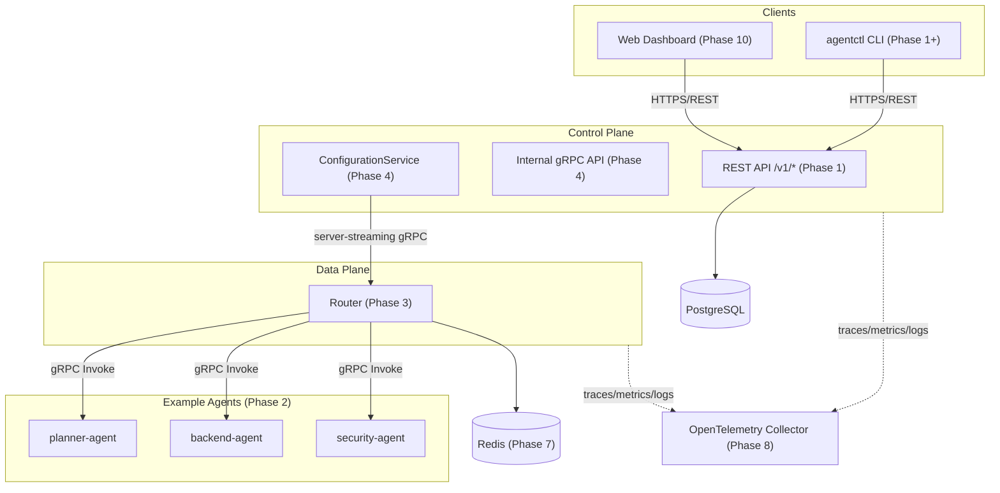

# AgentMesh Architecture

This document describes AgentMesh's **target** architecture. Components are
implemented incrementally across the phases listed in
[`docs/learning-guide.md`](learning-guide.md); this diagram shows where each
one fits, whether or not it exists yet.

**Current status:** Phase 1 complete. The control plane exposes a REST API
for tenants, agents, and capabilities backed by PostgreSQL
(`/v1/tenants/...`, plus `/healthz` and `/readyz`). The data plane, the
example agents, and configuration distribution are not implemented yet.

## Component Diagram

## Components

| Component | Responsibility | Implemented in |
|---|---|---|
| Control plane REST API | Tenant/agent/route/policy management | Phase 1 |
| Control plane internal gRPC API | Configuration distribution, router status | Phase 4 |
| Data-plane router | Capability routing, tenant enforcement, reliability | Phase 3, 7 |
| Example agents | Deterministic mock capability providers | Phase 2 |
| `agentctl` CLI | Operator-facing command-line client | Phase 1+ |
| Web dashboard | Read-only visualization of platform state | Phase 10 |
| PostgreSQL | Source of truth for all control-plane state (ADR 0002) | Phase 1 |
| Redis | Ephemeral state only: rate limits, idempotency keys | Phase 7 |
| OpenTelemetry stack | Tracing, metrics, logs | Phase 8 |

## Phase 1 Data Model

Three tables, migrated by `internal/migrate` from
`internal/migrate/migrations/0001_init.sql`:

- **`tenants`** — the top-level isolation unit. `slug` (URL-safe, used in
  `/v1/tenants/{slug}`) is `UNIQUE`; `status` is `active` or `suspended`,
  defaulting to `active`.
- **`agents`** — one row per registered agent, owned by exactly one
  tenant via `tenant_id REFERENCES tenants(id) ON DELETE CASCADE`. `name`
  is unique per tenant — `UNIQUE (tenant_id, name)` — not globally unique,
  so two tenants may each register a `security-agent`. `status` starts at
  `unknown` and is not yet driven by any heartbeat (that arrives in
  Phase 2).
- **`capabilities`** — one row per capability an agent announces (e.g.
  `security-review` / `v1`), owned by exactly one agent via `agent_id
  REFERENCES agents(id) ON DELETE CASCADE`. `(agent_id, name, version)` is
  `UNIQUE`.

The `UNIQUE (tenant_id, name)` constraint on `agents` is the only thing
that actually prevents two concurrent `POST
/v1/tenants/{slug}/agents` requests for the same name from both
succeeding — the store does not pre-check for an existing name before
inserting. See "Multi-tenancy enforced by the schema" in the learning
guide for the concurrent-create test that proves this.

Deleting a tenant cascades to its agents and their capabilities; deleting
an agent cascades to its capabilities. No table has a soft-delete column —
deletion in Phase 1 is physical.

**No endpoint is authenticated yet.** Every `/v1/*` route, `/healthz`, and
`/readyz` currently accept any caller. Phase 5 adds authentication and
authorization. See the README's Security Model section and the learning
guide's "Known gaps carried into later phases" for the related gap around
the `suspended` value of `TenantStatus` (`domain.TenantSuspended`) having
no enforced behavioural meaning yet.

## Trust Boundaries

Trust boundaries (client → control plane, router → agents, control plane →
router) and the mTLS/workload-identity model that secures them are documented
in `docs/security-model.md`, created in Phase 9.

## Configuration Flow

The desired-state → snapshot → push → apply → acknowledge → drift-detect
flow is documented in detail in `docs/consistency-model.md`, created in
Phase 6 (see ADR 0004 and ADR 0005 for the design rationale).
