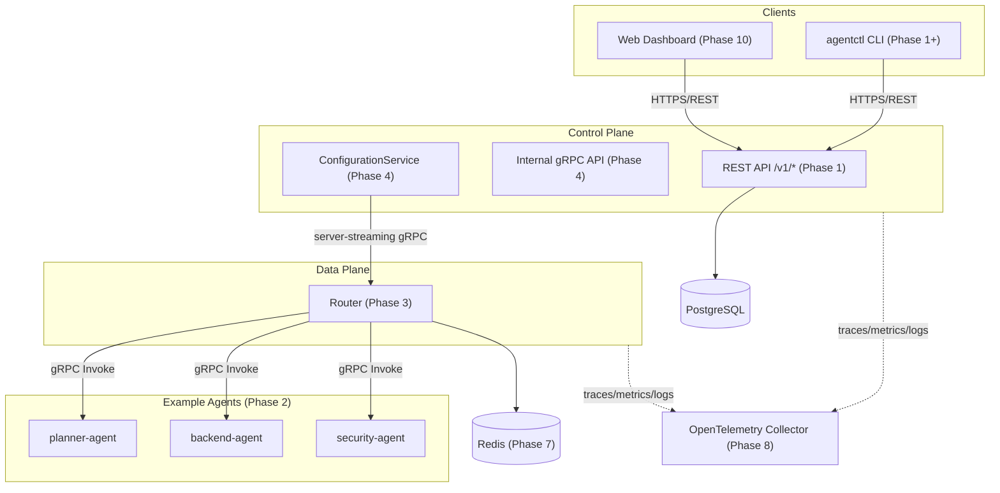

# AgentMesh Architecture

This document describes AgentMesh's **target** architecture. Components are
implemented incrementally across the phases listed in
[`docs/learning-guide.md`](learning-guide.md); this diagram shows where each
one fits, whether or not it exists yet.

**Current status:** Phase 0 complete. Only the control-plane HTTP service
(`cmd/control-plane`, health endpoint only) is implemented. Everything else
below is planned.

## Component Diagram

## Components

| Component | Responsibility | Implemented in |
|---|---|---|
| Control plane REST API | Tenant/agent/route/policy management | Phase 1 |
| Control plane internal gRPC API | Configuration distribution, router status | Phase 4 |
| Data-plane router | Capability routing, tenant enforcement, reliability | Phase 3, 7 |
| Example agents | Deterministic mock capability providers | Phase 2 |
| `agentctl` CLI | Operator-facing command-line client | Phase 1+ |
| Web dashboard | Read-only visualization of platform state | Phase 10 |
| PostgreSQL | Source of truth for all control-plane state (ADR 0002) | Phase 1 |
| Redis | Ephemeral state only: rate limits, idempotency keys | Phase 7 |
| OpenTelemetry stack | Tracing, metrics, logs | Phase 8 |

## Trust Boundaries

Trust boundaries (client → control plane, router → agents, control plane →
router) and the mTLS/workload-identity model that secures them are documented
in `docs/security-model.md`, created in Phase 9.

## Configuration Flow

The desired-state → snapshot → push → apply → acknowledge → drift-detect
flow is documented in detail in `docs/consistency-model.md`, created in
Phase 6 (see ADR 0004 and ADR 0005 for the design rationale).
