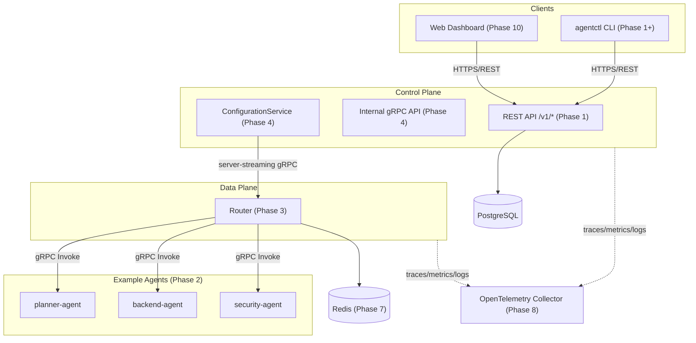

# AgentMesh Phase 0 (Bootstrap) Implementation Plan

> **For agentic workers:** REQUIRED SUB-SKILL: Use superpowers:subagent-driven-development (recommended) or superpowers:executing-plans to implement this plan task-by-task. Steps use checkbox (`- [ ]`) syntax for tracking.

**Goal:** Bootstrap the AgentMesh repository — module, minimal control-plane health endpoint, proto tooling scaffold, lint config, Makefile, ADRs, and documentation skeletons — so every later phase has a working foundation.

**Architecture:** A single Go module (`agentmesh`) with `cmd/control-plane` as the only runnable binary this phase. It depends on two small internal packages (`internal/observability` for structured logging, `internal/config` for env-based configuration) that later services (router, agents) will also depend on. Protobuf tooling (`buf`) is configured but no services are defined yet — that starts in Phase 2.

**Tech Stack:** Go 1.26 (stdlib `net/http`, `log/slog`, `context`), buf for protobuf tooling, golangci-lint v2.

## Global Constraints

- Go module path: `agentmesh` (local-only, no VCS host prefix).
- Go version: 1.26 (installed toolchain is go1.26.4).
- golangci-lint v2.12.0 is installed — config MUST use the v2 schema (`version: "2"`, `formatters:` section separate from `linters:`), not the v1 schema.
- License: MIT.
- Do not create `cmd/*`, `migrations/`, `deploy/`, `web/` directories or any package without real content in this phase — later phases create those when they have work to put in them.
- Every denied/error path returns wrapped errors (`fmt.Errorf("...: %w", err)`); no ignored errors.
- No global mutable state; construct dependencies (logger, config) explicitly and pass them in.

---

### Task 1: Go module and repository baseline

**Files:**
- Create: `go.mod`
- Create: `.gitignore`
- Create: `LICENSE`

**Interfaces:**
- Produces: Go module `agentmesh` that all later tasks' packages live under (e.g. `agentmesh/internal/config`).

- [ ] **Step 1: Initialize the Go module**

Run: `go mod init agentmesh`
Expected: creates `go.mod` with `module agentmesh` and a `go` directive. Open it afterward and confirm/set the go directive to `go 1.26`.

- [ ] **Step 2: Create `.gitignore`**

```gitignore
# Go build artifacts
/bin/
*.exe
*.test
*.out

# Environment
.env
.env.local

# IDE
.idea/
.vscode/

# OS
.DS_Store

# Local dev artifacts
*.log
```

- [ ] **Step 3: Create `LICENSE`**

```text
MIT License

Copyright (c) 2026 AgentMesh Contributors

Permission is hereby granted, free of charge, to any person obtaining a copy
of this software and associated documentation files (the "Software"), to deal
in the Software without restriction, including without limitation the rights
to use, copy, modify, merge, publish, distribute, sublicense, and/or sell
copies of the Software, and to permit persons to whom the Software is
furnished to do so, subject to the following conditions:

The above copyright notice and this permission notice shall be included in all
copies or substantial portions of the Software.

THE SOFTWARE IS PROVIDED "AS IS", WITHOUT WARRANTY OF ANY KIND, EXPRESS OR
IMPLIED, INCLUDING BUT NOT LIMITED TO THE WARRANTIES OF MERCHANTABILITY,
FITNESS FOR A PARTICULAR PURPOSE AND NONINFRINGEMENT. IN NO EVENT SHALL THE
AUTHORS OR COPYRIGHT HOLDERS BE LIABLE FOR ANY CLAIM, DAMAGES OR OTHER
LIABILITY, WHETHER IN AN ACTION OF CONTRACT, TORT OR OTHERWISE, ARISING FROM,
OUT OF OR IN CONNECTION WITH THE SOFTWARE OR THE USE OR OTHER DEALINGS IN THE
SOFTWARE.
```

- [ ] **Step 4: Verify and commit**

Run: `go build ./...`
Expected: exits 0 (no Go files yet, nothing to build).

```bash
git add go.mod .gitignore LICENSE
git commit -m "chore: initialize Go module and repository baseline"
```

---

### Task 2: Structured logging package

**Files:**
- Create: `internal/observability/logger.go`
- Test: `internal/observability/logger_test.go`

**Interfaces:**
- Consumes: `go.mod` module `agentmesh` (Task 1).
- Produces: `func NewLogger(w io.Writer, service, level string) *slog.Logger` — used by `cmd/control-plane/main.go` (Task 4) and every later service's `main.go`.

- [ ] **Step 1: Write the failing test**

```go
// internal/observability/logger_test.go
package observability

import (
	"bytes"
	"encoding/json"
	"testing"
)

func TestNewLogger_LevelFiltering(t *testing.T) {
	tests := []struct {
		name        string
		level       string
		wantEmitted bool
	}{
		{"info level filters debug messages", "info", false},
		{"debug level emits debug messages", "debug", true},
		{"unknown level defaults to info", "bogus", false},
		{"empty level defaults to info", "", false},
	}

	for _, tt := range tests {
		t.Run(tt.name, func(t *testing.T) {
			var buf bytes.Buffer
			logger := NewLogger(&buf, "test-service", tt.level)

			logger.Debug("debug message")

			gotEmitted := buf.Len() > 0
			if gotEmitted != tt.wantEmitted {
				t.Errorf("emitted = %v, want %v", gotEmitted, tt.wantEmitted)
			}
		})
	}
}

func TestNewLogger_IncludesServiceField(t *testing.T) {
	var buf bytes.Buffer
	logger := NewLogger(&buf, "control-plane", "info")
	logger.Info("startup")

	var entry map[string]any
	if err := json.Unmarshal(buf.Bytes(), &entry); err != nil {
		t.Fatalf("failed to parse log output: %v", err)
	}
	if entry["service"] != "control-plane" {
		t.Errorf("service field = %v, want control-plane", entry["service"])
	}
	if entry["msg"] != "startup" {
		t.Errorf("msg field = %v, want startup", entry["msg"])
	}
}
```

- [ ] **Step 2: Run test to verify it fails**

Run: `go test ./internal/observability/... -v`
Expected: FAIL — `undefined: NewLogger` (package doesn't exist yet).

- [ ] **Step 3: Write the implementation**

```go
// internal/observability/logger.go
// Package observability provides shared structured-logging setup for every
// AgentMesh service.
package observability

import (
	"io"
	"log/slog"
)

// NewLogger returns a JSON structured logger that writes to w at the given
// level, tagged with the given service name on every entry. Valid levels are
// "debug", "info", "warn", "error"; any other value (including "") defaults
// to "info".
func NewLogger(w io.Writer, service, level string) *slog.Logger {
	handler := slog.NewJSONHandler(w, &slog.HandlerOptions{Level: parseLevel(level)})
	return slog.New(handler).With("service", service)
}

func parseLevel(level string) slog.Level {
	switch level {
	case "debug":
		return slog.LevelDebug
	case "warn":
		return slog.LevelWarn
	case "error":
		return slog.LevelError
	default:
		return slog.LevelInfo
	}
}
```

- [ ] **Step 4: Run test to verify it passes**

Run: `go test ./internal/observability/... -v -race`
Expected: PASS (both tests, all subtests).

- [ ] **Step 5: Commit**

```bash
git add internal/observability/logger.go internal/observability/logger_test.go
git commit -m "feat: add structured JSON logger package"
```

---

### Task 3: Environment-based configuration loader

**Files:**
- Create: `internal/config/config.go`
- Test: `internal/config/config_test.go`

**Interfaces:**
- Consumes: `go.mod` module `agentmesh` (Task 1).
- Produces: `type Config struct { HTTPAddr string; LogLevel string; ShutdownTimeout time.Duration }` and `func Load() (*Config, error)` — used by `cmd/control-plane/main.go` (Task 4).

- [ ] **Step 1: Write the failing test**

```go
// internal/config/config_test.go
package config

import (
	"testing"
	"time"
)

func TestLoad_Defaults(t *testing.T) {
	cfg, err := Load()
	if err != nil {
		t.Fatalf("Load() returned error: %v", err)
	}
	if cfg.HTTPAddr != defaultHTTPAddr {
		t.Errorf("HTTPAddr = %q, want %q", cfg.HTTPAddr, defaultHTTPAddr)
	}
	if cfg.LogLevel != defaultLogLevel {
		t.Errorf("LogLevel = %q, want %q", cfg.LogLevel, defaultLogLevel)
	}
	if cfg.ShutdownTimeout != defaultShutdownTimeout {
		t.Errorf("ShutdownTimeout = %v, want %v", cfg.ShutdownTimeout, defaultShutdownTimeout)
	}
}

func TestLoad_OverridesFromEnv(t *testing.T) {
	t.Setenv("AGENTMESH_HTTP_ADDR", ":9090")
	t.Setenv("AGENTMESH_LOG_LEVEL", "debug")
	t.Setenv("AGENTMESH_SHUTDOWN_TIMEOUT", "5s")

	cfg, err := Load()
	if err != nil {
		t.Fatalf("Load() returned error: %v", err)
	}
	if cfg.HTTPAddr != ":9090" {
		t.Errorf("HTTPAddr = %q, want :9090", cfg.HTTPAddr)
	}
	if cfg.LogLevel != "debug" {
		t.Errorf("LogLevel = %q, want debug", cfg.LogLevel)
	}
	if cfg.ShutdownTimeout != 5*time.Second {
		t.Errorf("ShutdownTimeout = %v, want 5s", cfg.ShutdownTimeout)
	}
}

func TestLoad_InvalidLogLevel(t *testing.T) {
	t.Setenv("AGENTMESH_LOG_LEVEL", "verbose")

	_, err := Load()
	if err == nil {
		t.Fatal("Load() expected error for invalid log level, got nil")
	}
}

func TestLoad_InvalidShutdownTimeout(t *testing.T) {
	t.Setenv("AGENTMESH_SHUTDOWN_TIMEOUT", "not-a-duration")

	_, err := Load()
	if err == nil {
		t.Fatal("Load() expected error for invalid shutdown timeout, got nil")
	}
}

func TestLoad_EmptyHTTPAddrFallsBackToDefault(t *testing.T) {
	t.Setenv("AGENTMESH_HTTP_ADDR", "")

	cfg, err := Load()
	if err != nil {
		t.Fatalf("Load() returned error: %v", err)
	}
	if cfg.HTTPAddr != defaultHTTPAddr {
		t.Errorf("HTTPAddr = %q, want default %q", cfg.HTTPAddr, defaultHTTPAddr)
	}
}
```

- [ ] **Step 2: Run test to verify it fails**

Run: `go test ./internal/config/... -v`
Expected: FAIL — `undefined: Load` (package doesn't exist yet).

- [ ] **Step 3: Write the implementation**

```go
// internal/config/config.go
// Package config loads AgentMesh service configuration from environment
// variables, applying development-friendly defaults and validating values
// at startup so misconfiguration fails fast instead of surfacing later.
package config

import (
	"fmt"
	"os"
	"time"
)

// Config holds runtime configuration for the control-plane service.
type Config struct {
	// HTTPAddr is the address the control-plane HTTP server listens on.
	HTTPAddr string
	// LogLevel controls structured log verbosity: debug, info, warn, error.
	LogLevel string
	// ShutdownTimeout bounds how long graceful shutdown waits for in-flight
	// requests to finish before forcing an exit.
	ShutdownTimeout time.Duration
}

const (
	defaultHTTPAddr        = ":8080"
	defaultLogLevel        = "info"
	defaultShutdownTimeout = 10 * time.Second
)

// Load builds a Config from environment variables, applying defaults for
// anything unset. It returns an error if a set value is invalid.
func Load() (*Config, error) {
	cfg := &Config{
		HTTPAddr:        getEnvOrDefault("AGENTMESH_HTTP_ADDR", defaultHTTPAddr),
		LogLevel:        getEnvOrDefault("AGENTMESH_LOG_LEVEL", defaultLogLevel),
		ShutdownTimeout: defaultShutdownTimeout,
	}

	if raw, ok := os.LookupEnv("AGENTMESH_SHUTDOWN_TIMEOUT"); ok {
		d, err := time.ParseDuration(raw)
		if err != nil {
			return nil, fmt.Errorf("invalid AGENTMESH_SHUTDOWN_TIMEOUT %q: %w", raw, err)
		}
		cfg.ShutdownTimeout = d
	}

	if err := cfg.validate(); err != nil {
		return nil, err
	}

	return cfg, nil
}

func (c *Config) validate() error {
	switch c.LogLevel {
	case "debug", "info", "warn", "error":
	default:
		return fmt.Errorf("invalid AGENTMESH_LOG_LEVEL %q: must be one of debug, info, warn, error", c.LogLevel)
	}
	if c.HTTPAddr == "" {
		return fmt.Errorf("AGENTMESH_HTTP_ADDR must not be empty")
	}
	if c.ShutdownTimeout <= 0 {
		return fmt.Errorf("AGENTMESH_SHUTDOWN_TIMEOUT must be positive, got %s", c.ShutdownTimeout)
	}
	return nil
}

func getEnvOrDefault(key, def string) string {
	if v, ok := os.LookupEnv(key); ok && v != "" {
		return v
	}
	return def
}
```

- [ ] **Step 4: Run test to verify it passes**

Run: `go test ./internal/config/... -v -race`
Expected: PASS (all test functions).

- [ ] **Step 5: Commit**

```bash
git add internal/config/config.go internal/config/config_test.go
git commit -m "feat: add environment-based config loader"
```

---

### Task 4: Control-plane HTTP service with health endpoint

**Files:**
- Create: `cmd/control-plane/main.go`
- Test: `cmd/control-plane/main_test.go`

**Interfaces:**
- Consumes: `observability.NewLogger(w io.Writer, service, level string) *slog.Logger` (Task 2); `config.Load() (*config.Config, error)` and `config.Config{HTTPAddr, LogLevel, ShutdownTimeout}` (Task 3).
- Produces: the `cmd/control-plane` binary; an unexported `newMux() *http.ServeMux` used only by this package's tests.

- [ ] **Step 1: Write the failing test**

```go
// cmd/control-plane/main_test.go
package main

import (
	"net/http"
	"net/http/httptest"
	"testing"
)

func TestNewMux_HealthzRouting(t *testing.T) {
	tests := []struct {
		name       string
		method     string
		path       string
		wantStatus int
		wantBody   string
	}{
		{"GET /healthz succeeds", http.MethodGet, "/healthz", http.StatusOK, `{"status":"ok"}`},
		{"POST /healthz not allowed", http.MethodPost, "/healthz", http.StatusMethodNotAllowed, ""},
		{"unknown path returns 404", http.MethodGet, "/nope", http.StatusNotFound, ""},
	}

	mux := newMux()

	for _, tt := range tests {
		t.Run(tt.name, func(t *testing.T) {
			req := httptest.NewRequest(tt.method, tt.path, nil)
			rec := httptest.NewRecorder()

			mux.ServeHTTP(rec, req)

			if rec.Code != tt.wantStatus {
				t.Errorf("status = %d, want %d", rec.Code, tt.wantStatus)
			}
			if tt.wantBody != "" && rec.Body.String() != tt.wantBody {
				t.Errorf("body = %q, want %q", rec.Body.String(), tt.wantBody)
			}
		})
	}
}
```

- [ ] **Step 2: Run test to verify it fails**

Run: `go test ./cmd/control-plane/... -v`
Expected: FAIL — `undefined: newMux` (package doesn't exist yet).

- [ ] **Step 3: Write the implementation**

```go
// cmd/control-plane/main.go
package main

import (
	"context"
	"errors"
	"fmt"
	"io"
	"net/http"
	"os"
	"os/signal"
	"syscall"
	"time"

	"agentmesh/internal/config"
	"agentmesh/internal/observability"
)

func main() {
	if err := run(os.Stdout); err != nil {
		fmt.Fprintln(os.Stderr, err)
		os.Exit(1)
	}
}

func run(logOut io.Writer) error {
	cfg, err := config.Load()
	if err != nil {
		return fmt.Errorf("load config: %w", err)
	}

	logger := observability.NewLogger(logOut, "control-plane", cfg.LogLevel)

	srv := &http.Server{
		Addr:              cfg.HTTPAddr,
		Handler:           newMux(),
		ReadHeaderTimeout: 5 * time.Second,
	}

	ctx, stop := signal.NotifyContext(context.Background(), os.Interrupt, syscall.SIGTERM)
	defer stop()

	errCh := make(chan error, 1)
	go func() {
		logger.Info("starting control-plane HTTP server", "addr", cfg.HTTPAddr)
		if err := srv.ListenAndServe(); err != nil && !errors.Is(err, http.ErrServerClosed) {
			errCh <- err
			return
		}
		errCh <- nil
	}()

	select {
	case err := <-errCh:
		if err != nil {
			return fmt.Errorf("http server: %w", err)
		}
	case <-ctx.Done():
		logger.Info("shutdown signal received")
	}

	shutdownCtx, cancel := context.WithTimeout(context.Background(), cfg.ShutdownTimeout)
	defer cancel()

	if err := srv.Shutdown(shutdownCtx); err != nil {
		return fmt.Errorf("graceful shutdown: %w", err)
	}

	logger.Info("control-plane stopped cleanly")
	return nil
}

func newMux() *http.ServeMux {
	mux := http.NewServeMux()
	mux.HandleFunc("GET /healthz", healthHandler)
	return mux
}

func healthHandler(w http.ResponseWriter, _ *http.Request) {
	w.Header().Set("Content-Type", "application/json")
	w.WriteHeader(http.StatusOK)
	_, _ = w.Write([]byte(`{"status":"ok"}`))
}
```

- [ ] **Step 4: Run test to verify it passes**

Run: `go test ./cmd/control-plane/... -v -race`
Expected: PASS (all three routing cases).

- [ ] **Step 5: Manually verify the running server**

Run: `go run ./cmd/control-plane &` then `curl -s -D- http://localhost:8080/healthz` then stop the background process with `kill %1` (or Ctrl+C if run in foreground).
Expected: HTTP `200 OK`, `Content-Type: application/json`, body `{"status":"ok"}`; a JSON log line for "starting control-plane HTTP server" appears on stdout; the process exits cleanly (logs "control-plane stopped cleanly") when interrupted.

- [ ] **Step 6: Commit**

```bash
git add cmd/control-plane/main.go cmd/control-plane/main_test.go
git commit -m "feat: add control-plane HTTP service with health endpoint"
```

---

### Task 5: Protobuf tooling scaffold

**Files:**
- Create: `api/proto/buf.yaml`
- Create: `api/proto/buf.gen.yaml`
- Create: `api/proto/agentmesh/v1/common.proto`

**Interfaces:**
- Consumes: `go.mod` module `agentmesh` (Task 1), for the `go_package` import path.
- Produces: `agentmesh.v1.RequestMetadata` and `agentmesh.v1.ErrorDetail` proto messages, reused by the service `.proto` files defined in Phase 2. The `make generate` target added in Task 6 depends on `buf.gen.yaml` existing here.

- [ ] **Step 1: Write `api/proto/buf.yaml`**

```yaml
version: v2
modules:
  - path: .
lint:
  use:
    - STANDARD
breaking:
  use:
    - FILE
```

- [ ] **Step 2: Write `api/proto/buf.gen.yaml`**

```yaml
version: v2
plugins:
  - local: protoc-gen-go
    out: gen/go
    opt: paths=source_relative
  - local: protoc-gen-go-grpc
    out: gen/go
    opt: paths=source_relative
```

- [ ] **Step 3: Write `api/proto/agentmesh/v1/common.proto`**

```proto
syntax = "proto3";

package agentmesh.v1;

import "google/protobuf/timestamp.proto";

option go_package = "agentmesh/api/proto/gen/go/agentmesh/v1;agentmeshv1";

// RequestMetadata carries cross-cutting request context that is propagated
// across every AgentMesh RPC: correlation IDs and tracing information.
// Services embed this rather than redefining these fields, so request
// correlation stays consistent as new services are added.
message RequestMetadata {
  // request_id is a client- or gateway-generated identifier used to
  // correlate a single logical request across services and logs.
  string request_id = 1;

  // trace_id is the W3C trace context trace ID, when distributed tracing
  // is active for the request.
  string trace_id = 2;

  // requested_at is when the caller issued the request, as recorded by the
  // originating service.
  google.protobuf.Timestamp requested_at = 3;
}

// ErrorDetail is the structured error payload returned by AgentMesh gRPC
// services in addition to the standard gRPC status code, so clients can
// distinguish domain-specific failure reasons (e.g. "route not found" vs
// "tenant suspended") without parsing status messages.
message ErrorDetail {
  // code is a stable, machine-readable error identifier, e.g.
  // "TENANT_NOT_FOUND" or "CAPABILITY_UNAVAILABLE".
  string code = 1;

  // message is a human-readable description safe to display to operators.
  string message = 2;
}
```

- [ ] **Step 4: Attempt code generation (requires network access)**

Run (from repo root):
```bash
command -v buf >/dev/null 2>&1 || go install github.com/bufbuild/buf/cmd/buf@v1.47.2
command -v protoc-gen-go >/dev/null 2>&1 || go install google.golang.org/protobuf/cmd/protoc-gen-go@v1.36.3
command -v protoc-gen-go-grpc >/dev/null 2>&1 || go install google.golang.org/grpc/cmd/protoc-gen-go-grpc@v1.5.1
cd api/proto && PATH="$(go env GOPATH)/bin:$PATH" buf generate
```
Expected: if network access to the Go module proxy is available, this installs the three tools and generates `api/proto/gen/go/agentmesh/v1/common.pb.go`. **If network access is unavailable in this environment, this step will fail at the `go install` stage — record that honestly as a known limitation rather than treating it as blocking the rest of Phase 0.** The `.proto` source and buf config are the actual Phase 0 deliverable; generated code is exercised for real starting in Phase 2 once service RPCs exist.

- [ ] **Step 5: Commit**

```bash
git add api/proto/buf.yaml api/proto/buf.gen.yaml api/proto/agentmesh/v1/common.proto
# If Step 4 produced generated code, add it too:
git add -A api/proto/gen 2>/dev/null || true
git commit -m "feat: add protobuf tooling scaffold with common message types"
```

---

### Task 6: Lint configuration and Makefile

**Files:**
- Create: `.golangci.yml`
- Create: `Makefile`

**Interfaces:**
- Consumes: package paths from Tasks 1–5 (`./cmd/control-plane`, `./internal/...`, `api/proto`).
- Produces: `make build`, `make test`, `make lint`, `make generate`, `make run-control-plane`, plus stub targets (`migrate`, `seed`, `dev`, `run-router`, `run-agents`, `load-test`, `profile`, `compose-down`) that later phases replace with real implementations.

- [ ] **Step 1: Write `.golangci.yml`** (golangci-lint v2 schema — installed version is v2.12.0)

```yaml
version: "2"

run:
  timeout: 5m

linters:
  default: standard
  enable:
    - bodyclose
    - gosec
    - revive
  exclusions:
    paths:
      - api/proto/gen

formatters:
  enable:
    - gofmt
    - goimports
```

- [ ] **Step 2: Write `Makefile`**

```makefile
SHELL := /bin/bash
GOBIN := $(shell go env GOPATH)/bin

.PHONY: help
help: ## Show this help
	@grep -E '^[a-zA-Z_-]+:.*?## .*$$' $(MAKEFILE_LIST) | sort | awk 'BEGIN {FS = ":.*?## "}; {printf "  %-20s %s\n", $$1, $$2}'

.PHONY: build
build: ## Build all Go binaries
	go build ./...

.PHONY: test
test: ## Run unit tests with race detector
	go test -race ./...

.PHONY: lint
lint: ## Run golangci-lint
	golangci-lint run ./...

.PHONY: generate
generate: ## Regenerate code from protobuf definitions (installs buf + plugins on first run; requires network access)
	@command -v buf >/dev/null 2>&1 || { echo "installing buf..."; go install github.com/bufbuild/buf/cmd/buf@v1.47.2; }
	@command -v protoc-gen-go >/dev/null 2>&1 || { echo "installing protoc-gen-go..."; go install google.golang.org/protobuf/cmd/protoc-gen-go@v1.36.3; }
	@command -v protoc-gen-go-grpc >/dev/null 2>&1 || { echo "installing protoc-gen-go-grpc..."; go install google.golang.org/grpc/cmd/protoc-gen-go-grpc@v1.5.1; }
	cd api/proto && PATH="$(GOBIN):$$PATH" buf generate

.PHONY: run-control-plane
run-control-plane: ## Run the control-plane service locally
	go run ./cmd/control-plane

.PHONY: migrate
migrate: ## Apply database migrations (implemented in Phase 1)
	@echo "not implemented yet: database migrations arrive in Phase 1"

.PHONY: seed
seed: ## Load demo tenant/agent seed data (implemented in Phase 1)
	@echo "not implemented yet: seed data arrives in Phase 1"

.PHONY: dev
dev: ## Start the full local stack via Docker Compose (implemented in Phase 8)
	@echo "not implemented yet: docker-compose stack arrives in Phase 8"

.PHONY: run-router
run-router: ## Run the data-plane router locally (implemented in Phase 3)
	@echo "not implemented yet: router service arrives in Phase 3"

.PHONY: run-agents
run-agents: ## Run the example agents locally (implemented in Phase 2)
	@echo "not implemented yet: example agents arrive in Phase 2"

.PHONY: load-test
load-test: ## Run k6/ghz load tests against the router (implemented in Phase 12)
	@echo "not implemented yet: load tests arrive in Phase 12"

.PHONY: profile
profile: ## Capture CPU/heap/mutex profiles (implemented in Phase 12)
	@echo "not implemented yet: profiling workflow arrives in Phase 12"

.PHONY: compose-down
compose-down: ## Tear down the Docker Compose stack (implemented in Phase 8)
	@echo "not implemented yet: docker-compose stack arrives in Phase 8"
```

- [ ] **Step 3: Verify**

Run: `make build && make test && make lint`
Expected: `build` and `test` succeed (reusing Tasks 1–4). `lint` may report findings on first run — fix any real issues it surfaces in the files created so far; do not disable rules to silence it.

- [ ] **Step 4: Commit**

```bash
git add .golangci.yml Makefile
git commit -m "chore: add lint configuration and Makefile"
```

---

### Task 7: Architecture Decision Records

**Files:**
- Create: `docs/adr/0000-template.md`
- Create: `docs/adr/0001-native-go-router-instead-of-envoy.md`
- Create: `docs/adr/0002-postgresql-as-source-of-truth.md`
- Create: `docs/adr/0003-immutable-route-snapshots.md`
- Create: `docs/adr/0004-server-streaming-grpc-for-configuration-distribution.md`
- Create: `docs/adr/0005-eventual-consistency-for-router-configuration.md`
- Create: `docs/adr/0006-rbac-before-full-opa-integration.md`
- Create: `docs/adr/0007-rest-for-management-grpc-for-data-plane.md`

**Interfaces:**
- None (documentation only; no code dependencies).

- [ ] **Step 1: Write `docs/adr/0000-template.md`**

```markdown
# ADR NNNN: <Title>

Status: Proposed | Accepted | Deprecated | Superseded by ADR-XXXX

## Context

What problem or forces led to this decision? What constraints apply?

## Decision

What was decided, stated as a clear, actionable sentence.

## Alternatives Considered

- **Alternative A** — why it was rejected.
- **Alternative B** — why it was rejected.

## Consequences

What becomes easier or harder as a result? What follow-up work does this
create?
```

- [ ] **Step 2: Write `docs/adr/0001-native-go-router-instead-of-envoy.md`**

```markdown
# ADR 0001: Native Go Router Instead of Envoy

Status: Accepted

## Context

AgentMesh needs a data-plane router that performs capability-based routing,
tenant isolation, and reliability policies (retries, timeouts, circuit
breakers) between agent clients and destination agents. Envoy, driven by
xDS, is the industry-standard proxy for this class of problem.

## Decision

Build a native Go data-plane router for v1 instead of adopting Envoy/xDS.

## Alternatives Considered

- **Envoy with an xDS control plane** — rejected for v1: implementing an
  xDS server is a significant undertaking on its own, and delegating
  routing to Envoy would hide the Go distributed-systems work this project
  exists to demonstrate.
- **Istio or another service-mesh sidecar** — rejected: even heavier than
  bare Envoy, and couples routing to Kubernetes, while AgentMesh must also
  run standalone via Docker Compose.

## Consequences

Full control over routing, authorization, and observability logic lives in
Go, which is the point of the project. In exchange, AgentMesh reimplements
things Envoy provides for free (extensive load-balancing algorithms, an
admin API, years of HTTP/2 edge-case handling). The configuration-snapshot
format and the gRPC configuration-distribution API (ADR 0004) are
deliberately modeled after xDS-style push/ack patterns so an Envoy/xDS data
plane could be introduced later without redesigning the control plane.
```

- [ ] **Step 3: Write `docs/adr/0002-postgresql-as-source-of-truth.md`**

```markdown
# ADR 0002: PostgreSQL as Source of Truth

Status: Accepted

## Context

The control plane must durably store tenants, agents, routes, policies,
invocations, and configuration snapshots, support relational queries (e.g.
"list invocations for tenant X in the last hour"), and enforce per-tenant
row scoping.

## Decision

PostgreSQL is the single source of truth for all control-plane state.

## Alternatives Considered

- **etcd or Consul** — rejected: well suited to small KV configuration
  blobs, but weak for relational queries, joins, and reporting.
- **A NoSQL document store** — rejected: routes, destinations, and policies
  are inherently relational; a document store would push joins into
  application code for no benefit.
- **Multiple databases split by concern** — rejected as premature; a single
  PostgreSQL instance is sufficient at this project's scale (YAGNI).

## Consequences

Enables PostgreSQL Row-Level Security as a defense-in-depth layer for
tenant isolation, and transactions for atomic configuration-snapshot
creation. Redis (introduced in later phases) is used only for ephemeral
state — rate-limit counters, short-lived idempotency records — never as a
second source of truth.
```

- [ ] **Step 4: Write `docs/adr/0003-immutable-route-snapshots.md`**

```markdown
# ADR 0003: Immutable Route Snapshots

Status: Accepted

## Context

The router evaluates a routing decision on every invocation and must do so
under concurrent reads while new configuration arrives from the control
plane. A mutex-guarded mutable route table would serialize the hot
invocation path against configuration updates.

## Decision

Represent applied router configuration as an immutable, versioned
snapshot. A configuration update builds an entirely new snapshot object and
swaps it in atomically (e.g. `atomic.Pointer`); readers never block on
writers and never observe a partially-updated configuration.

## Alternatives Considered

- **Mutex-guarded mutable maps** — rejected: readers and writers contend on
  the hot path, and holding a lock across a multi-field update risks torn
  reads.
- **Per-request database lookups** — rejected: makes routing latency depend
  on database availability and latency, defeating the purpose of a fast
  data-plane router.

## Consequences

Routing reads are lock-free with respect to concurrent configuration
updates, and the router can keep serving its last-known-good snapshot if
the control plane becomes unavailable. Cost: every configuration update
allocates a new snapshot — acceptable, since updates are rare relative to
invocation volume.
```

- [ ] **Step 5: Write `docs/adr/0004-server-streaming-grpc-for-configuration-distribution.md`**

```markdown
# ADR 0004: Server-Streaming gRPC for Configuration Distribution

Status: Accepted

## Context

Routers need to receive new configuration snapshots from the control plane
promptly, without the control plane tracking per-router polling schedules
and without every router hammering a REST endpoint on a tight loop.

## Decision

Routers open a long-lived server-streaming gRPC call
(`ConfigurationService.WatchConfiguration`) to the control plane; the
control plane pushes a new `ConfigurationSnapshot` message whenever the
router's tenant scope changes. Acknowledgement is a separate unary RPC
(`AcknowledgeConfiguration`) rather than part of a bidirectional stream.

## Alternatives Considered

- **Client polling over REST** — rejected: forces a trade-off between
  staleness and load that push-based streaming avoids.
- **A pub/sub broker (Kafka, NATS)** — rejected: adds an operational
  dependency for a v1 project where gRPC streaming already solves the
  problem.
- **Bidirectional streaming** — rejected: acknowledgements fit naturally as
  a separate unary RPC, keeping the watch stream simple and
  one-directional.

## Consequences

The router must handle stream reconnection (control-plane restarts,
network blips) and fall back to its last-applied snapshot meanwhile.
Delivery is at-least-once, not exactly-once — snapshot application must be
idempotent, which checksums make cheap to guarantee (re-applying the same
version is a no-op).
```

- [ ] **Step 6: Write `docs/adr/0005-eventual-consistency-for-router-configuration.md`**

```markdown
# ADR 0005: Eventual Consistency for Router Configuration

Status: Accepted

## Context

Multiple router instances exist. The control plane cannot guarantee that
every router applies a new configuration version at the same instant.

## Decision

AgentMesh accepts eventual consistency between desired configuration (held
by the control plane) and applied configuration (held by each router). The
control plane tracks per-router applied-version drift explicitly rather
than assuming updates are instantaneous.

## Alternatives Considered

- **Strong consistency via two-phase commit or quorum ack before serving
  traffic** — rejected: unnecessary coordination overhead for routing
  configuration that tolerates brief staleness, and would make the entire
  data plane unavailable if any single router is slow to acknowledge.
- **External config management (e.g. Kubernetes ConfigMaps + reload)** —
  rejected: reinvents the same eventual-consistency problem with less
  visibility into drift, and doesn't work for the Docker Compose-based
  local development environment.

## Consequences

A route or agent change is not instantly reflected on every router.
AgentMesh treats desired-vs-applied drift as a first-class, observable
state (surfaced via `config status` / `config drifts`, implemented in
Phase 6) rather than hiding it. The full consistency model is documented in
`docs/consistency-model.md` once drift detection ships.
```

- [ ] **Step 7: Write `docs/adr/0006-rbac-before-full-opa-integration.md`**

```markdown
# ADR 0006: RBAC Before Full OPA Integration

Status: Accepted

## Context

Authorization must gate both management API access (tenant/agent/route
CRUD) and data-plane invocation access (which identity may invoke which
capability). A general-purpose policy engine (OPA/Rego) is powerful but
adds real complexity: a new policy DSL, a policy-loading and versioning
story, and a new failure mode (policy evaluation errors).

## Decision

Implement role-based access control first (platform admin, tenant admin,
developer, viewer, agent service account, router service account) behind
an internal `authorization.Decider` interface. OPA, or another Rego-based
engine, is added later as an alternate or additional implementation of
that same interface.

## Alternatives Considered

- **Start with OPA/Rego from day one** — rejected for v1: the added
  operational and cognitive overhead isn't justified before basic
  tenant/role checks exist and are tested.
- **No authorization abstraction, ad hoc checks in handlers** — rejected:
  turns every denied-request code path into a special case and conflicts
  with the requirement that every denial be observable through consistent
  logging, metrics, and invocation records.

## Consequences

v1 authorization logic is simpler to reason about and test, at the cost of
being less expressive than Rego (no arbitrary attribute-based policies
yet). Because the `Decider` interface is fixed up front, adding OPA later
does not require changing every call site that checks authorization.
```

- [ ] **Step 8: Write `docs/adr/0007-rest-for-management-grpc-for-data-plane.md`**

```markdown
# ADR 0007: REST for Management API, gRPC for Data-Plane Operations

Status: Accepted

## Context

AgentMesh exposes two different kinds of API surface: human/CLI-facing CRUD
management (tenants, agents, routes) and machine-to-machine,
latency-sensitive data-plane operations (agent invocation, configuration
streaming, health and status reporting).

## Decision

Use a versioned REST/JSON API (`/v1/...`) for control-plane management
operations, and gRPC/protobuf for all internal data-plane and
control-plane-to-router communication (`AgentRouter`, `AgentService`,
`ConfigurationService`).

## Alternatives Considered

- **gRPC-only, fronted by grpc-gateway for REST** — rejected: adds a
  translation layer and generated-gateway complexity that isn't justified
  for what is fundamentally CRUD traffic from a CLI and dashboard.
- **REST-only, including router-to-agent invocation** — rejected: loses
  HTTP/2 multiplexing, native streaming, and strongly-typed contracts that
  matter for the high-frequency invocation path and for server-streaming
  configuration distribution.

## Consequences

Two API styles must be documented and maintained (OpenAPI for REST, `.proto`
for gRPC) instead of one, but each is used where it fits best: REST's
ubiquity and tooling for management, gRPC's performance and streaming for
the data plane. This is also a deliberate portfolio choice — it
demonstrates both API design disciplines rather than only one.
```

- [ ] **Step 9: Commit**

```bash
git add docs/adr
git commit -m "docs: add initial architecture decision records"
```

---

### Task 8: Documentation skeletons

**Files:**
- Create: `docs/architecture.md`
- Create: `docs/learning-guide.md`
- Create: `README.md`

**Interfaces:**
- Consumes: the components built in Tasks 1–7 (referenced by name/path in the docs).
- None produced (documentation only).

- [ ] **Step 1: Write `docs/architecture.md`**

```markdown
# AgentMesh Architecture

This document describes AgentMesh's **target** architecture. Components are
implemented incrementally across the phases listed in
[`docs/learning-guide.md`](learning-guide.md); this diagram shows where each
one fits, whether or not it exists yet.

**Current status:** Phase 0 complete. Only the control-plane HTTP service
(`cmd/control-plane`, health endpoint only) is implemented. Everything else
below is planned.

## Component Diagram



## Components

| Component | Responsibility | Implemented in |
|---|---|---|
| Control plane REST API | Tenant/agent/route/policy management | Phase 1 |
| Control plane internal gRPC API | Configuration distribution, router status | Phase 4 |
| Data-plane router | Capability routing, tenant enforcement, reliability | Phase 3, 7 |
| Example agents | Deterministic mock capability providers | Phase 2 |
| `agentctl` CLI | Operator-facing command-line client | Phase 1+ |
| Web dashboard | Read-only visualization of platform state | Phase 10 |
| PostgreSQL | Source of truth for all control-plane state (ADR 0002) | Phase 1 |
| Redis | Ephemeral state only: rate limits, idempotency keys | Phase 7 |
| OpenTelemetry stack | Tracing, metrics, logs | Phase 8 |

## Trust Boundaries

Trust boundaries (client → control plane, router → agents, control plane →
router) and the mTLS/workload-identity model that secures them are documented
in `docs/security-model.md`, created in Phase 9.

## Configuration Flow

The desired-state → snapshot → push → apply → acknowledge → drift-detect
flow is documented in detail in `docs/consistency-model.md`, created in
Phase 6 (see ADR 0004 and ADR 0005 for the design rationale).
```

- [ ] **Step 2: Write `docs/learning-guide.md`**

```markdown
# AgentMesh Learning Guide

This is the primary teaching document for the project. For every major
feature, once implemented, this guide explains: what problem it solves, why
it exists, how it works, which files are involved, how to test it, common
failure modes, how it relates to real distributed systems, alternative
approaches, and likely interview questions.

Entries are added phase by phase, as each feature is actually built — this
guide never describes behavior ahead of the code that implements it.

## Phase 0 — Bootstrap

### Structured JSON Logging

**What problem it solves:** every AgentMesh service needs consistent,
machine-parseable logs (service name, level, message, structured fields)
instead of ad hoc `fmt.Println` output.

**Why it exists:** structured logs are what make the later observability
work (Phase 8) — correlating logs with traces and metrics by request ID —
possible at all.

**How it works:** `internal/observability.NewLogger(w io.Writer, service,
level string) *slog.Logger` wraps the standard library's `log/slog` with a
`slog.NewJSONHandler`, pre-attaches a `service` field via `.With(...)`, and
maps a string level (`"debug"`, `"info"`, `"warn"`, `"error"`) to an
`slog.Level`, defaulting unknown values to `info`.

**Files involved:** `internal/observability/logger.go`,
`internal/observability/logger_test.go`.

**How to test it:** `go test ./internal/observability/... -v`. The tests
write to an in-memory `bytes.Buffer` (not `os.Stdout`) so log level
filtering and field presence can be asserted directly.

**Common failure modes:** passing an invalid level string silently falls
back to `info` rather than erroring — this is intentional (logging setup
should never itself crash a service), but it means a typo'd
`AGENTMESH_LOG_LEVEL` fails silently rather than loudly. Startup validation
in `internal/config` (see below) is what actually catches that typo.

**How it relates to real distributed systems:** production services almost
universally emit structured (usually JSON) logs so a log aggregator
(Loki, Elasticsearch, CloudWatch Logs Insights) can index and query
individual fields instead of grepping free text.

**Alternative approaches:** Zap (higher throughput, more allocation-tuned,
but another dependency and a different API from the stdlib); Logrus (older,
slower, mostly superseded by `slog` since Go 1.21). `slog` was chosen to
follow the project's own preference for standard-library patterns where
practical.

**Interview questions this might raise:** Why JSON logs over plain text?
What's the cost of structured logging vs. `fmt.Println`? How would you add
request-scoped fields (e.g. `trace_id`) to every log line inside a single
request's handler chain without passing the logger through every function
signature? (Hint for later phases: `context.Context`-carried logger, or
`slog.Logger.With` per request.)

### Environment-Based Configuration with Startup Validation

**What problem it solves:** services need runtime configuration (listen
address, log level, timeouts) that varies between local development,
tests, and (eventually) containers/Kubernetes — without a config file
format to parse and without silently running with a nonsensical value.

**Why it exists:** "fails fast at startup with a clear error" is much
cheaper to debug than "started fine, but requests behave strangely because
`AGENTMESH_LOG_LEVEL=verboes` was silently ignored."

**How it works:** `internal/config.Load() (*Config, error)` reads
environment variables (`AGENTMESH_HTTP_ADDR`, `AGENTMESH_LOG_LEVEL`,
`AGENTMESH_SHUTDOWN_TIMEOUT`), falls back to defaults for anything unset,
and calls an internal `validate()` method that rejects unknown log levels,
an empty address, or a non-positive shutdown timeout before `Load` ever
returns successfully.

**Files involved:** `internal/config/config.go`,
`internal/config/config_test.go`.

**How to test it:** `go test ./internal/config/... -v`. Tests use
`t.Setenv` (automatically restores the previous environment after each
test, and marks the test as non-parallel-safe) to exercise defaults,
overrides, and each validation failure path.

**Common failure modes:** forgetting that `t.Setenv` cannot be combined
with `t.Parallel()` in the same test — if a future test in this package
needs to run in parallel, it must not also call `t.Setenv`.

**How it relates to real distributed systems:** this is the same
"twelve-factor app" configuration pattern (config via environment,
validated at process start) used by virtually every container-native
service, because it works identically in a local shell, a Docker Compose
service, and a Kubernetes pod spec's `env:` block.

**Alternative approaches:** a YAML/TOML config file (adds a parsing
dependency and a file-path-resolution problem — where does the file live
in a container?); a flags-based CLI config library like `spf13/viper`
(more features than needed here, and another dependency, contra the
project's stdlib-first preference).

**Interview questions this might raise:** Why validate at startup instead
of at first use? What's the trade-off between environment variables and a
config file for secrets specifically? How would you support hot-reloading
configuration without restarting the process, and what parts of `Config`
would be unsafe to hot-reload (e.g. `HTTPAddr`, which is bound to a
listening socket) versus safe (e.g. `LogLevel`)?

### Graceful Shutdown

**What problem it solves:** a service killed mid-request (e.g. by a
Kubernetes pod eviction or a plain Ctrl-C) should finish in-flight work
rather than dropping connections abruptly.

**Why it exists:** this is a baseline production-readiness requirement
called out explicitly in the project's reliability goals — it matters even
more once the router is forwarding live agent invocations.

**How it works:** `cmd/control-plane/main.go`'s `run` function uses
`signal.NotifyContext` to build a `context.Context` that's cancelled on
`SIGINT`/`SIGTERM`, runs `http.Server.ListenAndServe` in a goroutine
reporting to an error channel, and on either an unexpected server error or
a shutdown signal, calls `http.Server.Shutdown` with a bounded
`context.WithTimeout(cfg.ShutdownTimeout)` so shutdown can't hang forever.

**Files involved:** `cmd/control-plane/main.go`.

**How to test it:** manually — `go run ./cmd/control-plane`, then send
`SIGINT` (Ctrl-C) or `SIGTERM` and confirm the "shutdown signal received"
and "control-plane stopped cleanly" log lines appear and the process exits
0. (No automated test for this yet; Task 4's automated tests cover routing
only. Testing signal-driven shutdown deterministically is worth revisiting
once the router, which has real in-flight-request stakes, is built in
Phase 3.)

**Common failure modes:** a `ShutdownTimeout` set too low truncates
legitimate in-flight requests; set to zero or negative, `config.Load`
rejects it at startup rather than allowing a server that shuts down
instantly.

**How it relates to real distributed systems:** this is exactly what
Kubernetes expects from a well-behaved pod: on `SIGTERM`, stop accepting
new work, finish what's in flight within the grace period, then exit —
otherwise the kubelet sends `SIGKILL` after `terminationGracePeriodSeconds`
and in-flight requests are simply dropped.

**Alternative approaches:** immediately closing all connections on signal
(simpler, but drops in-flight requests — unacceptable once real traffic
flows through this service); a supervisor/process-manager-driven restart
strategy instead of in-process signal handling (pushes the same problem
into infrastructure rather than solving it in the service).

**Interview questions this might raise:** What's the difference between
`http.Server.Close()` and `http.Server.Shutdown(ctx)`? What happens to a
request that's still running when the shutdown timeout expires? How does
this interact with a Kubernetes readiness probe (hint: Phase 7 adds
readiness/liveness endpoints — readiness should flip to "not ready"
*before* shutdown begins, so the load balancer stops sending new traffic
ahead of the process actually stopping).

### Protobuf Tooling (buf)

**What problem it solves:** protobuf/gRPC code generation via raw `protoc`
invocations is fragile (plugin versions, include paths, per-language flags
all have to match by hand across every developer's machine and CI).

**Why it exists:** Phase 2 defines real gRPC services on top of this
tooling; setting up the config now means Phase 2 is "write `.proto`, run
`make generate`," not "first invent a build pipeline."

**How it works:** `api/proto/buf.yaml` declares the module and enables
standard lint/breaking-change rules; `api/proto/buf.gen.yaml` declares two
local plugins (`protoc-gen-go`, `protoc-gen-go-grpc`) generating into
`api/proto/gen/go` with `paths=source_relative`. `make generate` installs
`buf` and both plugins via `go install` if missing, then runs `buf
generate`.

**Files involved:** `api/proto/buf.yaml`, `api/proto/buf.gen.yaml`,
`api/proto/agentmesh/v1/common.proto`, the `generate` target in `Makefile`.

**How to test it:** `make generate`, then confirm
`api/proto/gen/go/agentmesh/v1/common.pb.go` exists and `go build ./...`
still succeeds. This requires network access to the Go module proxy the
first time it runs (to install `buf` and the plugins); see the note in the
Phase 0 implementation plan if that step fails in a sandboxed environment.

**Common failure modes:** editing generated `.pb.go` files by hand — any
such edit is silently discarded the next time `make generate` runs. Proto
field renumbering or removal without following buf's breaking-change rules
(`buf breaking`) can silently break wire compatibility with already-deployed
clients.

**How it relates to real distributed systems:** schema-first API design
with generated, strongly-typed client/server code (protobuf, plus
alternatives like Thrift or Avro) is the standard way large systems keep
service boundaries in sync without hand-written serialization code, and
`buf`'s breaking-change detection is what stops an accidental
backward-incompatible field change from shipping.

**Alternative approaches:** raw `protoc` + shell scripts (more moving parts
to keep in sync across machines and CI, no built-in lint/breaking-change
checks); the Buf Schema Registry's remote plugins instead of locally
installed ones (removes the local `go install` step but adds a runtime
dependency on a third-party registry being reachable at generate time,
which is a worse fit for this project's "runs offline once dependencies are
cached" goal).

**Interview questions this might raise:** Why protobuf over JSON for
internal service-to-service calls? What does `paths=source_relative`
actually control? How does `buf breaking` know a change is
backward-incompatible, and what categories of proto change are always safe
(adding a new optional field) versus never safe (reusing a field number)?

## Phases 1–12

Not yet written — each phase's section is added here when that phase ships,
following the same structure as the Phase 0 entries above.
```

- [ ] **Step 3: Write `README.md`**

```markdown
# AgentMesh

A secure, multi-tenant control plane and Go/gRPC data plane for routing
communication between autonomous AI agents and internal tools.

## Project Status

**Phase 0 of 12 complete: repository bootstrap.**

What exists right now: a Go module, a control-plane service exposing only a
`/healthz` endpoint, protobuf tooling configuration (no services defined
yet), lint configuration, a Makefile, initial architecture decision
records, and documentation skeletons. Nothing else described in this README
is implemented yet — each section below says what phase delivers it.

See [`docs/learning-guide.md`](docs/learning-guide.md) for the full,
phase-by-phase build log and [`docs/architecture.md`](docs/architecture.md)
for the target architecture diagram.

## Problem Statement

Autonomous AI agents increasingly need to call each other and internal
tools — a planning agent handing work to a backend-implementation agent,
which hands off to a security-review agent, for example. Doing this safely
across multiple tenants requires the same problems any service mesh solves:
capability-based routing, authorization, tenant isolation, configuration
distribution, drift detection, and observability — applied to agent
traffic instead of generic microservice traffic.

## Architecture

AgentMesh separates a **control plane** (tenant/agent/route management,
desired configuration state — Go, PostgreSQL, REST + internal gRPC) from a
**data plane** (a native Go router that enforces that configuration on the
actual invocation path — no Envoy dependency for v1; see
[ADR 0001](docs/adr/0001-native-go-router-instead-of-envoy.md)). Full
diagram and component table: [`docs/architecture.md`](docs/architecture.md).

## Quick Start

Requires Go 1.26+.

```bash
git clone <this-repo>
cd agentmesh
make build
make run-control-plane
# in another terminal:
curl -s http://localhost:8080/healthz
# => {"status":"ok"}
```

## Example Workflow

Not yet implemented. The target demo scenario — a tenant `acme` with
`planner-agent`, `backend-agent`, and `security-agent` registered, and a
`security-review` request routed end-to-end — is described in the original
project brief and will be runnable starting once Phase 3 (basic router)
ships.

## Security Model

Not yet implemented. Threat model, trust boundaries, and mitigations will
be documented in `docs/security-model.md`, created in Phase 9 (mTLS) and
Phase 5 (multi-tenancy/authorization).

## Consistency Model

Not yet implemented in code, but the design decision is recorded now:
AgentMesh uses eventual consistency between desired and applied router
configuration, with explicit drift detection rather than an attempt at
strong consistency. See
[ADR 0005](docs/adr/0005-eventual-consistency-for-router-configuration.md).
Full write-up lands in `docs/consistency-model.md` in Phase 6.

## Observability

Not yet implemented. Structured JSON logging exists today
(`internal/observability`); metrics and distributed tracing arrive in
Phase 8.

## Performance Testing

Not yet implemented. Benchmarks, load tests, and a profiling workflow
arrive in Phase 12.

## Roadmap

| Phase | Delivers |
|---|---|
| 0 (this phase) | Repository bootstrap |
| 1 | Agent registry, basic control plane, REST API |
| 2 | gRPC agent contract, example agents |
| 3 | Basic router |
| 4 | Configuration distribution |
| 5 | Multi-tenancy and authorization |
| 6 | Drift detection and reconciliation |
| 7 | Reliability (retries, circuit breakers, rate limiting) |
| 8 | Observability (tracing, metrics, dashboards) |
| 9 | mTLS |
| 10 | Web dashboard |
| 11 | Kubernetes deployment |
| 12 | Performance and portfolio polish |

## Trade-offs

Key architectural trade-offs are recorded as ADRs in
[`docs/adr/`](docs/adr/) as they're made, rather than summarized here where
they'd go stale. Start with ADR 0001 (native Go router vs. Envoy) and
ADR 0005 (eventual consistency for router configuration).

## License

MIT — see [`LICENSE`](LICENSE).
```

- [ ] **Step 4: Commit**

```bash
git add docs/architecture.md docs/learning-guide.md README.md
git commit -m "docs: add architecture, learning guide, and README skeletons"
```

---

### Task 9: Final verification

**Files:** none (verification only).

**Interfaces:** none.

- [ ] **Step 1: Full build, vet, test, lint pass**

Run: `go build ./... && go vet ./... && go test -race ./... && golangci-lint run ./...`
Expected: all four commands exit 0. If `golangci-lint` reports findings, fix them in the affected files (do not add blanket `//nolint` suppressions) and re-run.

- [ ] **Step 2: End-to-end manual health check**

Run: `go run ./cmd/control-plane &`, then `curl -s -o /dev/null -w '%{http_code}\n' http://localhost:8080/healthz`, then stop the server (`kill %1`).
Expected: prints `200`; server logs show a JSON "starting control-plane HTTP server" line on start and "control-plane stopped cleanly" on shutdown.

- [ ] **Step 3: Confirm repository state**

Run: `git status` and `git log --oneline`
Expected: working tree clean (everything committed across Tasks 1–8); a linear commit history bootstrapping the module, logger, config, control-plane service, proto tooling, lint/Makefile, ADRs, and docs.

- [ ] **Step 4: Tag phase completion**

```bash
git commit --allow-empty -m "chore: complete Phase 0 (bootstrap)"
```
